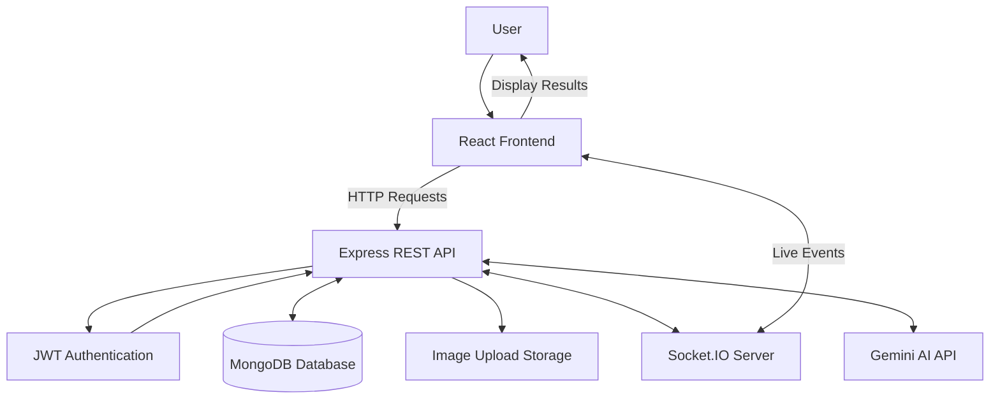
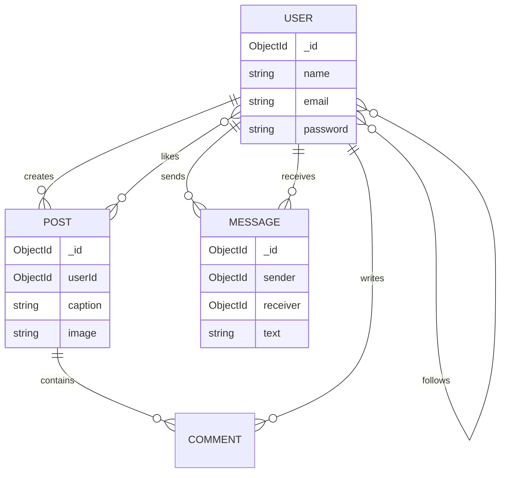
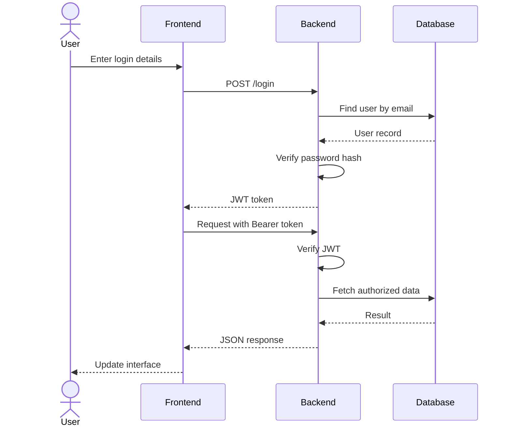
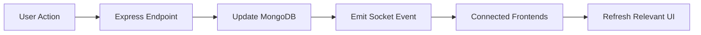

# 📸 Instagram-Clone
### A Full-Stack Social Media Application with Real-Time Features and AI Assistance

<p align="center">
  A modern social networking platform inspired by Instagram, built to support photo sharing, user interactions, messaging, and AI-powered content assistance.
</p>

---

## 📌 1. Project Overview

**Instagram-Clone** is a full-stack social media application that allows users to create accounts, share images, interact with posts, connect with other users, and communicate through messaging.

The project uses a React-based frontend, a Node.js and Express backend, MongoDB for data storage, Socket.IO for real-time events, and Google's Gemini API for AI-assisted content generation.

The main goal is to build a responsive, interactive, and maintainable social media platform while learning full-stack development, API integration, database management, authentication, and real-time application design.

## 🎯 2. Project Objectives

- Build a responsive and user-friendly social media interface.
- Implement secure user authentication.
- Enable users to create, view, like, comment on, and delete posts.
- Support follow and unfollow functionality.
- Provide messaging between eligible users.
- Integrate AI tools for caption generation and improvement.
- Implement real-time updates for supported social interactions.
- Maintain a modular architecture that can support future features.

---

## 🛠️ 3. Technology Stack

| Layer | Technology | Purpose |
|---|---|---|
| Frontend | React 19 | Interactive user interface |
| Build Tool | Vite | Development server and production builds |
| Styling | Tailwind CSS | Responsive styling and UI design |
| Icons | Lucide React | Consistent interface icons |
| Backend | Node.js | Server-side JavaScript runtime |
| API Framework | Express 5 | REST API and request handling |
| Database | MongoDB | Persistent application data |
| ODM | Mongoose | MongoDB schemas and queries |
| Authentication | JWT | Token-based authentication |
| Password Security | bcryptjs | Password hashing and verification |
| Image Uploads | Multer | Handling uploaded images |
| Real-Time Communication | Socket.IO | Live application events |
| AI Integration | Google Gemini API | AI-assisted caption and comment features |
| Environment Configuration | dotenv | Loading server environment variables |
| Deployment | Vercel / Render-compatible setup | Frontend and backend hosting |

---

## ✨ 4. Feature Overview

| Feature | Description | Implementation |
|---|---|---|
| 🔐 User Authentication | Register and log in with email and password | JWT and bcryptjs |
| 📰 Personalized Feed | View your own posts and posts from followed users | Express API and MongoDB |
| 📷 Image Sharing | Upload images with captions | React, Multer and MongoDB |
| ❤️ Likes | Like and unlike posts | REST API |
| 💬 Comments | Add comments to posts | Embedded comments in post documents |
| 👥 Follow System | Follow and unfollow other users | User relationship arrays |
| 👤 User Profiles | View profile information and connections | Profile API |
| ✏️ Profile Editing | Update the display name | Profile update API |
| 💌 Direct Messaging | Send and retrieve messages | Message API and MongoDB |
| ⚡ Live Updates | Receive events for posts, likes, comments, profile changes and messages | Socket.IO |
| 🤖 AI Caption Generation | Generate captions with AI assistance | Gemini API |
| ✨ Caption Enhancement | Improve existing captions | Gemini API |
| 🧠 AI Comment Assistance | Generate AI-assisted comment suggestions | Gemini API |
| 🖼️ Image-Aware AI | Send an image with a prompt for supported AI tasks | Image compression and Gemini API |
| 📱 Responsive Interface | Build an adaptable interface for different screen sizes | React and Tailwind CSS |

**Note:** This table describes the implemented feature areas identified in the source code. Individual features should be tested before being considered production-ready.

---

## 🏗️ 5. System Architecture

The application follows a client-server architecture.



### Architecture Components

| Component | Responsibility |
|---|---|
| Presentation Layer | Displays the feed, profiles, authentication screens, and interactive controls |
| API Layer | Handles incoming HTTP requests and returns application data |
| Authentication Layer | Verifies JWTs and identifies the requesting user |
| Data Layer | Stores users, posts, comments, likes, relationships, and messages |
| File Storage Layer | Stores uploaded image files and provides their URLs |
| Real-Time Layer | Broadcasts supported events to connected clients |
| AI Integration Layer | Sends prompts and optional image data to the Gemini API |

### Typical Request Flow

1. A user performs an action in the React interface.
2. The frontend sends a request to the Express backend.
3. Authentication middleware verifies the token when required.
4. The backend validates the request and interacts with MongoDB or another service.
5. The backend returns the result and emits a Socket.IO event when applicable.
6. The frontend updates the interface using the response or a real-time event.

---

## 📂 6. Project Directory Structure

```text
instagram/
│
├── frontend/
│   ├── public/
│   │   ├── favicon.svg
│   │   └── icons.svg
│   │
│   ├── src/
│   │   ├── assets/
│   │   ├── App.jsx
│   │   ├── App.css
│   │   ├── index.css
│   │   └── main.jsx
│   │
│   ├── index.html
│   ├── package.json
│   ├── vite.config.js
│   ├── tailwind.config.js
│   ├── postcss.config.js
│   └── vercel.json
│
├── backend/
│   ├── uploads/
│   ├── server.js
│   ├── package.json
│   ├── package-lock.json
│   └── .gitignore
│
└── README.md
```

*The structure above focuses on the application source. Generated folders, installed dependencies, and local environment files are intentionally excluded.*

### Important Files

| File | Responsibility |
|---|---|
| `frontend/src/App.jsx` | Main application interface, feature logic, API requests, and event handling |
| `frontend/src/main.jsx` | React application entry point |
| `frontend/src/App.css` | Application-specific styling |
| `frontend/src/index.css` | Global CSS and Tailwind directives |
| `frontend/package.json` | Frontend dependencies and development scripts |
| `backend/server.js` | Express server, database models, API endpoints, authentication, uploads, AI integration, and Socket.IO |
| `backend/package.json` | Backend dependencies |
| `frontend/vercel.json` | Frontend deployment configuration |

---

## 🗄️ 7. Database Architecture

The backend defines three main MongoDB models.

### 7.1 User Model

| Field | Type | Description |
|---|---|---|
| `_id` | ObjectId | Unique user identifier |
| `name` | String | Display name |
| `email` | String | Unique login email |
| `password` | String | Hashed password |
| `followers` | Array of ObjectIds | Users following this account |
| `following` | Array of ObjectIds | Accounts followed by this user |

### 7.2 Post Model

| Field | Type | Description |
|---|---|---|
| `_id` | ObjectId | Unique post identifier |
| `userId` | ObjectId | Reference to the post owner |
| `caption` | String | Post caption |
| `image` | String | Image URL |
| `likes` | Array of ObjectIds | Users who liked the post |
| `comments` | Array of objects | Comment text, author and creation time |
| `createdAt` | Date | Post creation timestamp |
| `updatedAt` | Date | Last update timestamp |

### 7.3 Message Model

| Field | Type | Description |
|---|---|---|
| `_id` | ObjectId | Unique message identifier |
| `sender` | ObjectId | Sender's user ID |
| `receiver` | ObjectId | Recipient's user ID |
| `text` | String | Message content |
| `createdAt` | Date | Message creation timestamp |
| `updatedAt` | Date | Last update timestamp |

### Entity Relationship Diagram



**Implementation detail:** Comments are embedded inside post documents in the current schema. The diagram represents their logical relationship, not a separate MongoDB collection.

---

## 🔌 8. API Architecture

The backend exposes REST endpoints for the main application features.

| Method | Endpoint | Purpose | Authentication |
|---|---|---|---|
| GET | `/` | Check server availability | No |
| POST | `/register` | Register a new user | No |
| POST | `/login` | Authenticate a user | No |
| GET | `/profile` | Get the current user's profile | Yes |
| PUT | `/update-profile` | Update the user's display name | Yes |
| GET | `/posts` | Fetch the personalized post feed | Yes |
| POST | `/create-post` | Upload an image and create a post | Yes |
| PUT | `/like` | Like or unlike a post | Yes |
| POST | `/comment` | Add a comment to a post | Yes |
| DELETE | `/delete-post/:id` | Delete a post owned by the user | Yes |
| GET | `/users` | Retrieve suggested users | Yes |
| PUT | `/follow/:id` | Follow or unfollow a user | Yes |
| POST | `/send-message` | Send a direct message | Yes |
| GET | `/messages/:userId` | Retrieve a conversation | Yes |
| POST | `/gemini` | Request AI-assisted content generation | Yes |
| GET | `/uploads/*` | Serve uploaded media files | Public file access |

*Authentication indicates whether the current backend implementation uses JWT middleware. It does not, by itself, guarantee that every endpoint has complete authorization or validation.*

### Authentication Flow



---

## ⚡ 9. Real-Time Event Architecture

The application uses Socket.IO to broadcast changes to connected clients.

| Event | Trigger | Purpose |
|---|---|---|
| `new_post` | Post creation | Notify clients about a new post |
| `update-like` | Like or unlike | Broadcast the updated post |
| `new-comment` | Comment creation | Broadcast the updated comments |
| `profile_updated` | Profile update | Notify clients of profile changes |
| `new_message` | Message creation | Broadcast a new message |
| `delete_post` | Post deletion | Notify clients that a post was removed |

### Real-Time Data Flow



**Important:** The current backend uses broad event broadcasting. Before production use, events should be scoped to authorized users or conversation rooms, especially for private messages and personal data.

---

## 🤖 10. AI Integration

The application integrates with Google's Gemini API to provide AI-assisted content features.

| AI Feature | Input | Expected Output |
|---|---|---|
| Caption Generation | User prompt and optional image | Suggested caption |
| Caption Enhancement | Existing caption | Improved caption |
| Comment Assistance | User prompt or post context | Suggested comment |
| Image-Aware Assistance | Text prompt and compressed image | Context-aware text response |

### AI Request Flow

1. The user selects an AI feature.
2. The frontend prepares the prompt and optionally compresses the image.
3. The frontend sends an authenticated request to `/gemini`.
4. The backend forwards the request to the Gemini API using a server-side API key.
5. The backend returns the result.
6. The frontend displays the generated content for the user.

### AI Security Requirements

- Keep the Gemini API key on the backend.
- Never expose API keys in frontend source code or public repositories.
- Validate prompt and image sizes.
- Handle rate limits, API failures, and malformed responses.
- Avoid logging sensitive prompts, images, tokens, or secrets.
- Ask the user before automatically publishing AI-generated content.

---

## 🎨 11. UI/UX and Interaction Principles

The interface should feel modern, smooth, and easy to use.

| Area | Design Requirement |
|---|---|
| Layout | Clear navigation and consistent spacing |
| Colors | Consistent brand palette and accessible contrast |
| Buttons | Visible hover, focus, loading, and disabled states |
| Forms | Clear labels, validation and helpful error messages |
| Posts | Well-presented images, captions, likes and comments |
| Profiles | Easy access to user details and social connections |
| Messaging | Clear distinction between sent and received messages |
| AI Tools | Loading indicators and readable generated results |
| Responsive Design | Support mobile, tablet and desktop layouts |
| Feedback | Show success messages, errors and empty states |
| Accessibility | Keyboard navigation, meaningful labels and image alt text |

### Interaction Checklist

- [ ] Forms validate input before submitting.
- [ ] Buttons show a loading state while requests are running.
- [ ] Likes update correctly without duplicate entries.
- [ ] Comments appear under the correct post.
- [ ] Follow and unfollow states remain consistent.
- [ ] Messages appear in the correct conversation.
- [ ] Uploaded images display correctly.
- [ ] Empty feeds and API failures have helpful messages.
- [ ] Real-time events do not create duplicate posts or messages.
- [ ] UI elements work on touchscreens and with keyboard navigation.

---

## 🚀 12. Local Installation and Setup

### Prerequisites

- Node.js and npm
- MongoDB database or MongoDB Atlas connection
- Gemini API key for AI features
- Git, if you want to manage version control

### Step 1: Install Frontend Dependencies

```bash
cd frontend
npm install
```

Start the development server:

```bash
npm run dev
```

### Step 2: Install Backend Dependencies

Open a second terminal:

```bash
cd backend
npm install
```

### Step 3: Configure Environment Variables

Create a `.env` file inside the `backend` directory:

```env
PORT=5000
MONGO_URL=your_mongodb_connection_string
JWT_SECRET=your_long_random_secret
GEMINI_KEY=your_gemini_api_key
```

Use your own credentials. Never commit this file to a public repository.

### Step 4: Start the Backend

The current backend package does not define a start script, so run:

```bash
node server.js
```

The backend should listen on port `5000`, unless another port is configured.

### Step 5: Configure the Frontend API URL

The frontend currently uses a hosted backend URL as its default. For local development, create `frontend/.env.local`:

```env
VITE_API_URL=http://localhost:5000
```

Restart the Vite development server after changing environment variables.

### Step 6: Open the Application

Open the local URL printed by Vite in your browser. Register an account and test the available features.

**Troubleshooting:** If the frontend cannot connect, check the backend terminal, MongoDB connection, API URL, CORS configuration and environment variables.

---

## 🔐 13. Security and Reliability

The project should be improved in the following areas before production deployment.

| Priority | Area | Recommended Improvement |
|---|---|---|
| Critical | JWT Secret | Remove the insecure fallback secret and fail startup if the secret is missing |
| Critical | API Keys | Rotate any exposed keys and keep secrets out of source control |
| High | Authorization | Verify ownership and access rights on every protected resource |
| High | Messaging | Restrict conversation access to its participants |
| High | Socket.IO | Use authenticated connections and private rooms for sensitive events |
| High | CORS | Allow only trusted frontend origins |
| High | Input Validation | Validate and sanitize all incoming request data |
| High | File Uploads | Validate file type, file size, content and storage permissions |
| High | Rate Limiting | Add suitable limits to login, registration and other sensitive routes |
| Medium | Error Handling | Return consistent error responses without exposing internal details |
| Medium | Logging | Remove sensitive debugging output and use structured server logs |
| Medium | Database | Add useful indexes and appropriate data validation |
| Medium | Testing | Add API, integration, authorization and frontend tests |

**Security note:** The existing source includes permissive CORS settings and a fallback JWT secret. These should be fixed before exposing the backend to public traffic.

---

## 🧪 14. Testing Strategy

| Test Area | What to Verify |
|---|---|
| Authentication | Registration, login, invalid passwords and expired tokens |
| Posts | Creation, image upload, feed retrieval and deletion permissions |
| Likes | Like, unlike and repeated requests |
| Comments | Correct author, post association and input validation |
| Profiles | Profile retrieval and updates |
| Follow System | Follow, unfollow, duplicate actions and self-follow prevention |
| Messaging | Sending, retrieving and unauthorized conversation access |
| AI Integration | Valid prompts, rate limits, API errors and image requests |
| Real-Time | Correct event delivery and duplicate-event handling |
| Responsive UI | Layout and interactions across common screen sizes |

### Definition of Done

A feature is complete only when:

- [ ] Its expected behavior works.
- [ ] Invalid inputs are handled.
- [ ] Unauthorized access is prevented.
- [ ] The UI displays loading, success and error states.
- [ ] Existing features are not broken.
- [ ] Relevant tests pass.

---

## 🗺️ 15. Development Roadmap

| Phase | Focus | Status |
|---|---|---|
| Phase 1 | Project setup and core UI | Existing codebase |
| Phase 2 | Authentication and user profiles | Implemented feature area |
| Phase 3 | Posts, likes, comments and follow system | Implemented feature area |
| Phase 4 | Messaging and Socket.IO events | Implemented feature area |
| Phase 5 | Gemini AI integration | Implemented feature area |
| Phase 6 | Security hardening and validation | Improvement required |
| Phase 7 | Automated testing and bug fixing | To be strengthened |
| Phase 8 | Deployment reliability and monitoring | Ongoing improvement |
| Phase 9 | Advanced features and performance | Future enhancement |

### Future Enhancements

- Story creation and viewing.
- Notifications and activity history.
- Search users and discover content.
- User avatars and richer profile customization.
- Image storage using a dedicated cloud media service.
- Pagination and optimized feed loading.
- Message read receipts and typing indicators.
- Improved real-time authorization.
- Dark mode and additional accessibility features.
- Automated deployment and continuous integration.

---

## 📈 16. Performance and Scalability

As the application grows, prioritize the following:

1. Paginate posts, users and message history.
2. Add database indexes for frequently queried fields.
3. Optimize images before uploading and consider responsive image sizes.
4. Avoid broadcasting private events to every connected client.
5. Use a dedicated media service for production-scale uploads.
6. Separate routes, controllers, models and middleware into modules.
7. Add automated tests and monitoring before introducing major changes.
8. Cache only where it improves performance without exposing private data.

---

## 📋 17. Project Summary

| Attribute | Details |
|---|---|
| Project Name | Instagram-Clone |
| Project Type | Full-Stack Web Application |
| Domain | Social Networking |
| Frontend | React, Vite, Tailwind CSS |
| Backend | Node.js, Express |
| Database | MongoDB with Mongoose |
| Authentication | JWT and bcryptjs |
| Real-Time Technology | Socket.IO |
| AI Service | Google Gemini API |
| Main Function | Image sharing and social interaction |
| Current Architecture | Client-server with REST APIs and real-time events |
| Primary Goal | Build an interactive, maintainable and secure social media platform |

---

## 🤝 18. Contribution Guidelines

1. Understand the existing architecture before modifying code.
2. Keep frontend and backend responsibilities separate.
3. Use clear, consistent names for variables, functions and API routes.
4. Validate user input and handle errors properly.
5. Never commit `.env` files, API keys, database credentials or authentication tokens.
6. Test existing functionality after every major change.
7. Document new API endpoints and environment variables.
8. Keep commits focused on a single change.

---

## 📄 19. License

This project is intended for educational and development purposes. Add an appropriate license before distributing or reusing the code publicly.

---

# 🧠 20. Instructions for ChatGPT — Project Development Context

When assisting with this Instagram-Clone project, follow these rules:

### Project Understanding

- Treat the project as an existing full-stack application, not a new project to build from scratch.
- Refer to the actual source code before claiming a feature is implemented.
- Use React, Vite, Tailwind CSS, Express, MongoDB, JWT, Socket.IO and Gemini API as the current technology stack.
- Preserve the existing architecture unless a change is necessary.
- Clearly distinguish existing features from proposed improvements.

### Coding Rules

1. Give complete, working code when requested.
2. Specify the exact file path for every code change.
3. Explain where to insert new code or which code to replace.
4. Do not remove existing functionality when adding a new feature.
5. Reuse existing API endpoints and components where appropriate.
6. Explain new dependencies and provide their installation commands.
7. Keep frontend API URLs configurable through environment variables.
8. Handle loading states, errors, validation and edge cases.
9. Never hardcode production secrets or expose backend credentials.
10. Check whether changes are compatible with the existing source code.

### UI/UX Rules

- Aim for a polished, modern, responsive social media interface.
- Use consistent spacing, typography, colors and icons.
- Add meaningful hover effects and transitions without excessive animation.
- Include mobile, tablet and desktop layouts.
- Ensure all interactive controls perform their stated actions.
- Maintain accessibility and readable contrast.

### Debugging Rules

When debugging:

1. Identify the root cause before suggesting a fix.
2. Explain the problem in simple English.
3. Provide the corrected code and exact file location.
4. Check related frontend, backend, database and environment settings.
5. Avoid changing unrelated files.
6. Provide clear steps to reproduce and verify the fix.

### Feature Development Workflow

For every new feature:

1. Understand the requirement.
2. Inspect the relevant existing files.
3. Explain the proposed approach.
4. Identify frontend, backend and database changes.
5. Implement the changes with complete code.
6. Explain setup and testing steps.
7. Check security, edge cases and compatibility.

**Primary objective:** Help develop Instagram-Clone into a polished, reliable, secure and scalable full-stack social media application while preserving working features and keeping the code understandable for a student developer.
